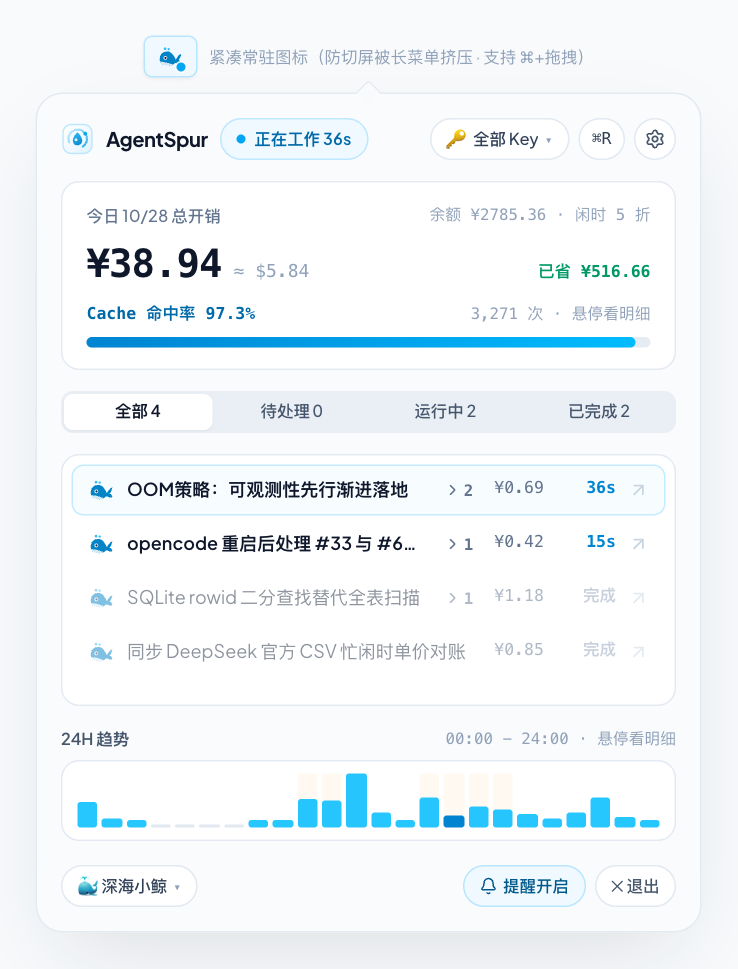
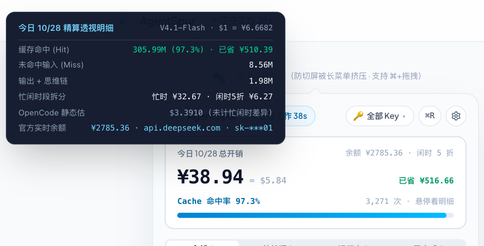
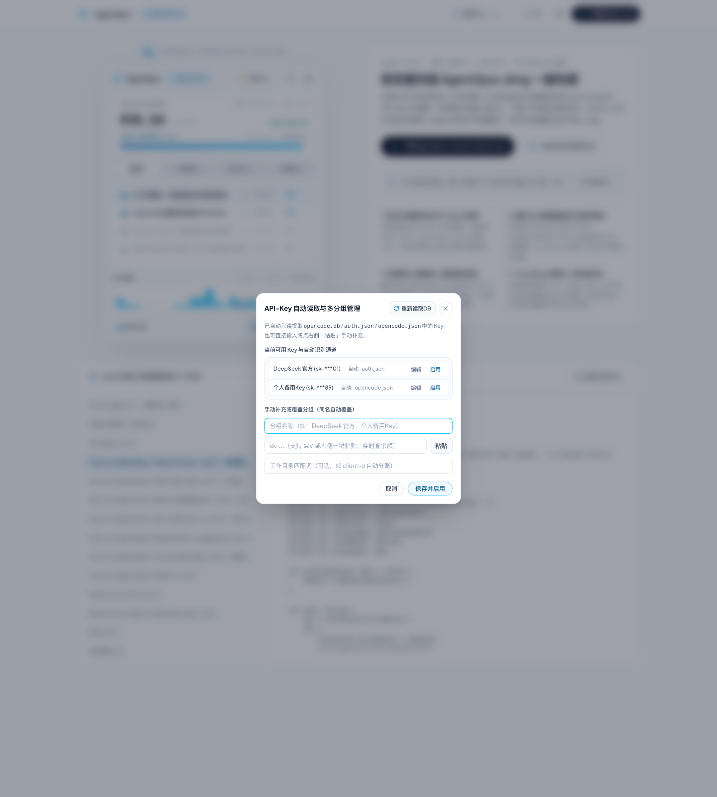

# AgentSpur (macOS 原生极简菜单栏监控)

**AgentSpur** 是一款纯原生 macOS `AppKit` 菜单栏 Agent 状态与费用精算监控工具（**无 WebView · 无 Electron · 无后端服务 · 无常驻守护进程**），专为 `opencode TUI`、`Terminal.app`、`iTerm2` 与 `tmux` 打造，严格以 `SQLITE_OPEN_READONLY | SQLITE_OPEN_NOMUTEX` 只读方式解析本机 `~/.local/share/opencode/opencode.db`。

<p align="center">
  
</p>

---

## 一键打包成 `.dmg` 安装镜像（推荐）

系统要求：**macOS 14.0 (Sonoma) 及以上**，并已安装系统自带编译工具链（若未安装，终端执行 `xcode-select --install` 即可，无需安装完整版 Xcode，无需安装任何第三方依赖）。

### 方法 A：在访达 (Finder) 中直接双击打包
1. 将源码下载并解压到 Mac 任意目录。
2. 直接双击目录中的 **`双击打包DMG.command`**（若首次提示权限，可在终端执行一次 `chmod +x build_dmg.sh 双击打包DMG.command`）。
3. 脚本会自动编译 Release 二进制、渲染生成高清 1:1 等比冰瓷流体专属图标 `AppIcon.icns`、组装 `AgentSpur.app`、完成本机 Ad-Hoc 签名，并在当前目录输出 **`AgentSpur.dmg`** 并自动在 Finder 中高亮选中。
4. 双击打开 `AgentSpur.dmg`，将 **AgentSpur** 拖入 **Applications（应用程序）** 文件夹即可启动。

### 方法 B：在终端 / iTerm2 中一行命令打包
```bash
chmod +x build_dmg.sh && ./build_dmg.sh
# 或使用 Makefile:
make dmg
```

---

## 核心特性与极简重构亮点

1. **纯净顶栏与多 API-Key `<1ms` 极速分账切换**：
   - 剔除底层库文件名与调试杂质，左侧仅保留 1:1 等比 **AgentSpur 徽标**与实时运行状态胶囊，右侧统一为 28pt 等高窄边框胶囊控制组（全局 `🔑 API-Key / 币种切换`、`↻ ⌘R`、`⚙︎ 设置`）。
   - 在本机 `~/Library/Application Support/AgentSpur/telemetry_cache.sqlite` 建立 `(api_key, timestamp)` 复合索引（`idx_usage_key_time`）并配合内存预聚合分片，切换多 API-Key 分组耗时 `<0.2ms`，**绝不全表扫描或写入 `opencode.db`**。

2. **极简开销卡片、手风琴会话列表与 24H 迷你柱状图**：
   - **开销卡片减负**：突出展示今日总开销大字与双色 Cache 命中率进度条，忙闲时拆分、未命中与输出思维链明细收纳至鼠标悬停 Tooltip。
   - **子代理默认折叠**：去除沉重嵌套蓝框，采用轻盈单行列表；子任务（`@dev`、`@explore`）默认折叠，按需点击 `▸` 展开，已完成历史任务自动弱化透明度以突出运行中焦点。
   - **24H 迷你趋势柱状图**：去除坐标轴与网格杂讯，微透底色区分忙闲时，悬停柱体即时浮窗展示该小时请求数与精算开销。

3. **原生系统提示音与前台通知修复**：
   - 完整实现 `UNUserNotificationCenterDelegate` 前台横幅展示与 `AppKit NSSound` 原生提示音（`Glass` / `Ping` / `Basso`），底部工具栏一键切换 `🔔 提醒开启 / 🔕 已静音`，并支持在 `⚙︎` 菜单中一键自检测试。

## 界面与交互

| 开销明细 Tooltip | API-Key 顶层 Sheet |
|---|---|
|  |  |
| 指针跟随，优先左侧/上方，`z-index: 9999` | `createPortal` 到 `body`，`z-[100]` + `backdrop-blur` |


## 测试与验证

### 原生菜单栏 AX 自动化（6/6 PASS）

```bash
./native-tests/run_menu_bar_test.sh
```

- 只使用 `AXPress` / AX 读取，不做坐标点击；覆盖：进程存在、状态项标题、Popover 打开、Popover 文本、Popover 收起、收尾清理。
- 需要 macOS「辅助功能」权限；实际结果写入 `native-tests/result.txt`，脱敏示例见 [`native-tests/result.example.txt`](native-tests/result.example.txt)。
- 当前实测：6/6 PASS，`EXIT_CODE: 0`。

### 本次修复

- `RolePackSpriteIcon` 的 SVG 显式 `preserveAspectRatio="xMidYMid meet"`，按包围盒 `<g transform>` 居中，避免菜单栏图标被挤压。
- API-Key Sheet 通过 `createPortal` 挂到 `body`，`fixed inset-0 z-[100]` + `backdrop-blur`，不再被 Popover 遮挡。
- 开销明细卡与图标 Tooltip 改为跟随鼠标、优先左侧/上方，`z-index: 9999`，视口内 clamp。
- 菜单栏图标状态由会话状态派生，Popover 收起后仍更新；状态点常驻 DOM，避免条件渲染导致状态丢失。

> 截图说明：以上为 Web 1:1 交互预览（与原生 App 共用同一套 UI 结构）的 Playwright 截图；原生 AX 测试证据为 `native-tests/result.example.txt`。原生视频录制需要额外授予「屏幕录制」权限，未包含在仓库中。
